# Demand & Inventory Decision Lab

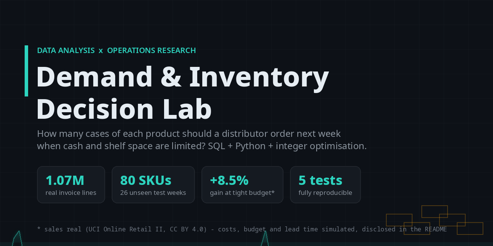


-teal)

-orange)

**With a limited weekly purchasing budget, limited storage and fixed case-packs, how many cases of each product should a distributor order next week - and does an optimiser actually beat a simple reorder rule?**

Data Analysis (SQL cleaning, demand analysis, forecast backtests, BI exports) feeding Operations Research (an integer purchasing model solved with the free HiGHS solver via SciPy), evaluated out of sample on real sales data.

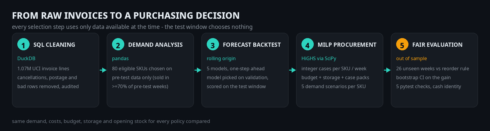

## What is real and what is simulated

| Real (UCI Online Retail II, CC BY 4.0) | Simulated assumptions (`src/config.py`) |
|---|---|
| 1,067,371 invoice lines, UK giftware retailer / wholesalers, Dec 2009 to Dec 2011 | Unit cost = 50-75% of median price (random per SKU, seeded) |
| Units sold per product per week | Holding/obsolescence 3% of cost per week |
| Cancellations/returns | Case packs 6/12/24, storage volume per unit, 1-week lead time |
| | Weekly budget and storage capacity, derived from training-period demand |

Caveats stated out loud: units sold are a **proxy** for demand (the data has no stockouts, so true demand is unobserved); revenue is not profit; costs, lead times and capacity are invented; the business is a UK gift wholesaler, not tea or an Egyptian company. Source: https://archive.ics.uci.edu/dataset/502/online%2Bretail%2Bii

## Results (26 out-of-sample weeks, simulated profit)

| Policy | Profit | Fill rate |
|---|---|---|
| Reorder rule + naive forecast | 264.8k | 88.6% |
| Optimiser + naive forecast | 268.3k | 90.5% |
| Reorder rule + MA8 | 264.8k | 88.2% |
| Optimiser + MA8 | 267.7k | 89.2% |
| One-week perfect-information benchmark | 305.2k | 98.2% |

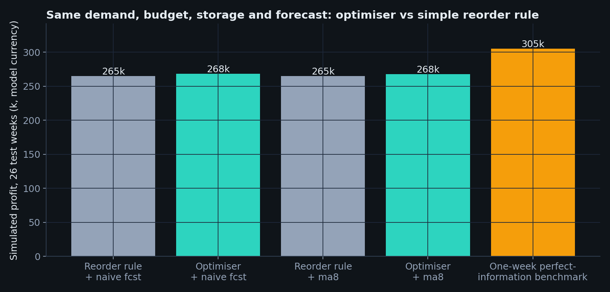

- At the default budget the optimiser is **+1.1%** (+2.9k) over the reorder rule, better in 17 of 26 weeks and worse in 9 (worst week -0.4k). **Uncertainty:** an i.i.d. weekly bootstrap gives a 95% CI of +0.1k to +5.8k, but weeks are not independent (stock carries over, demand is autocorrelated). A 4-week moving-block bootstrap gives **-1.1k to +6.0k, which includes zero**. 2.5k of the 2.9k came in the last 4 weeks (November peak). **The default-budget gain is unproven; I report it that way.**
- Tight budget: **+2.4%** at 0.8x and **+8.5%** at 0.6x of typical COGS (all 5 cost seeds positive, minimum across all 20 runs +0.6%). At 1.3x it is +0.7%. The seeds vary only the simulated unit costs; they do not vary the demand history, so they do not measure demand uncertainty.
- Closing stock is valued at cost, not written off. The optimiser ends with 1.4k more stock (11.0k vs 9.6k). Writing closing stock off entirely would cut its lead to +1.5k (+0.6%).
- The better forecast barely matters: naive and MA8 end close. MA beat naive in forecast error (WAPE 0.56 vs 0.68 test); the seasonal variant did **not** help.
- The gap to the perfect-information benchmark (~14%) is mostly demand uncertainty, which none of the policies removes. That benchmark is myopic (greedy week by week), so it is a reference point, not a proven upper bound.
- Solver: HiGHS reported optimal on every MILP solve (main runs and all 20 sensitivity runs). Longest single solve 0.21 s.

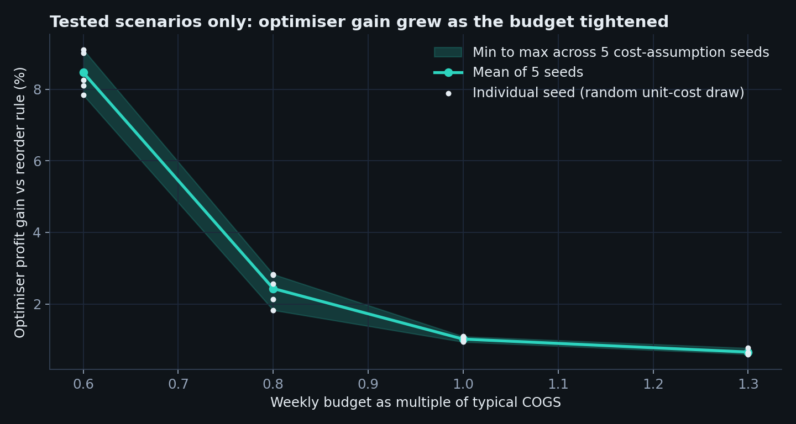
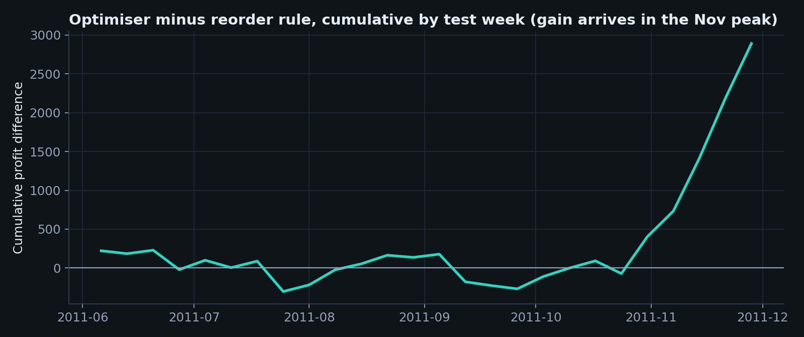
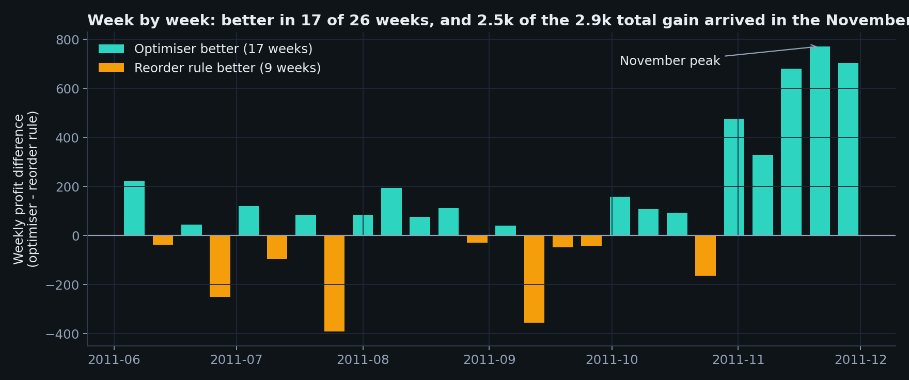
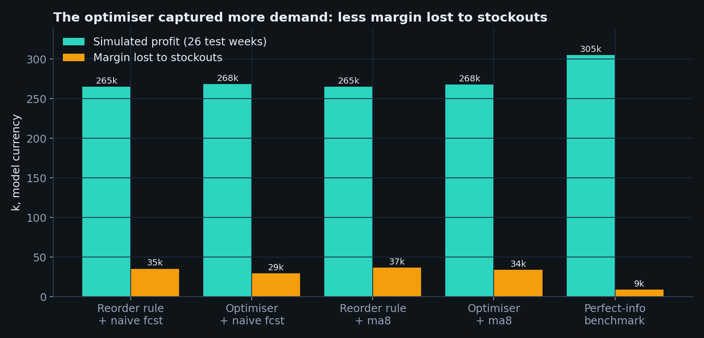

## The data

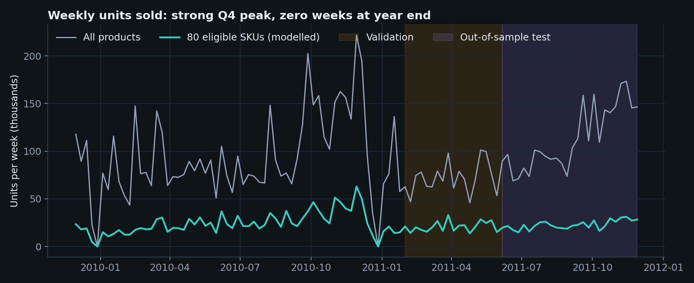
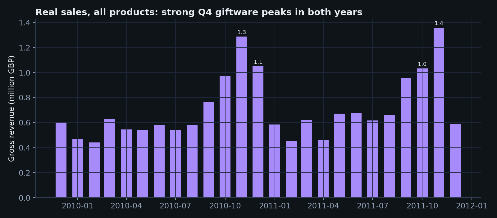
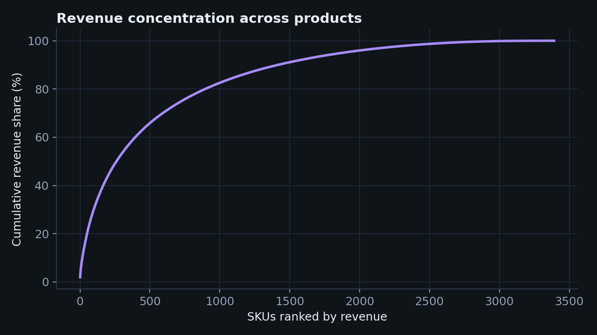
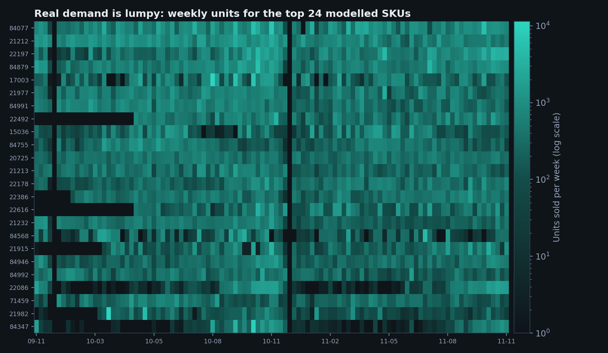

Two years of weekly demand with a strong Q4 peak; revenue concentrated in a few hundred of ~3,500 products. The 80 modelled SKUs carry 24.6% of all units sold.

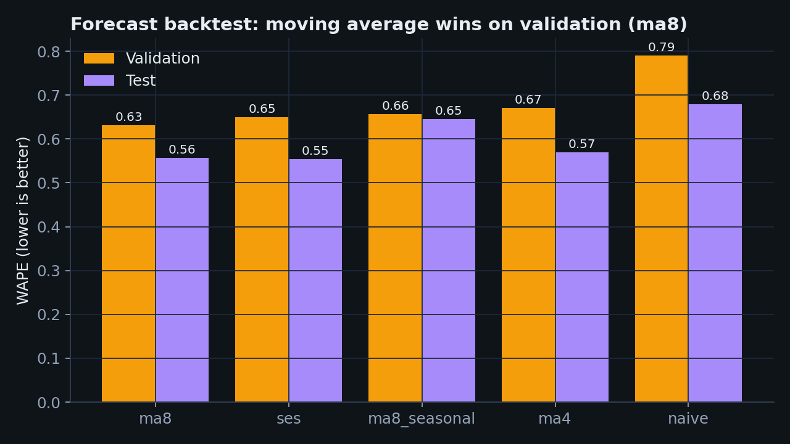

## Audit notes (fair-evaluation checks)

- Same demand, costs, budget, storage, case packs, 1-week lead time and opening stock for every policy; a test asserts equal demand.
- Decision at end of week t uses only data up to t (a test changes future demand and checks forecasts do not move). Scenario errors and sigma come from errors already observed.
- Selection on pre-test data only: SKU eligibility, forecast model (validation WAPE), reorder-rule `z` (validation profit), case packs, budget and capacity (training demand). The test window is never used to choose anything. Sensitivity runs re-tune `z` on validation for each setting and are scenario reports, not selection.
- Accounting: profit = revenue - COGS of units sold - holding on leftover. The cash identity holds to rounding for every policy (`reports/summary.json`). Opening stock is the same for all policies and is free.
- The reorder rule is deliberately simple (pro-rata shrink when budget/storage bind, tuned `z`); a smarter rule would narrow the gap.

## Dashboard and Power BI

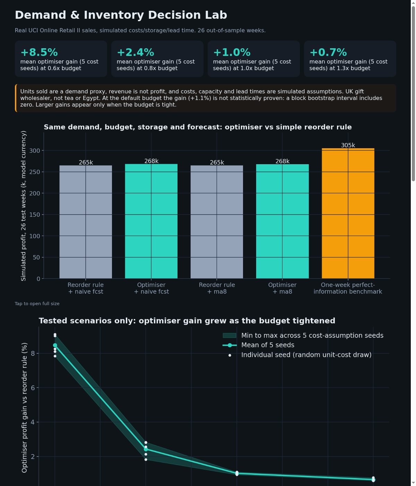

`dashboard.html` is a static summary - open it in a browser and tap a chart for full size. The `powerbi/` folder holds tidy CSVs ready for Power BI Desktop. **A native `.pbix` was not built**; load the CSVs to build one.

## Run it

Prerequisites: Python 3.10+, internet on first run (downloads the ~45 MB UCI zip, converts it to CSV in 1 to 2 minutes), about 500 MB disk and 2 GB RAM. Arabic steps: `QUICKSTART_AR.md`.

```
pip install -r requirements.txt
bash run_all.sh        # download, clean, forecast, simulate, figures, Power BI CSVs
python -m pytest tests # or: python tests/test_lab.py
```

Verified on Linux from a fresh folder. Windows steps are included in `QUICKSTART_AR.md` but were not execution-verified.

## Limits

One warehouse, one-week horizon (myopic: leftover stock is only charged holding cost), lost sales, no supplier price breaks, 80 SKUs, one 26-week test period.

## Method detail

1. `sql/01_clean.sql` (DuckDB): drop cancellations, non-product codes (postage, fees), non-positive quantity/price; counts in `reports/cleaning_audit.csv`.
2. Eligible SKUs chosen **only from pre-test data**: sold in >=70% of the 52 weeks before the test; top 80 by volume.
3. Forecasts (naive, MA4, MA8, exponential smoothing, MA8 with aggregate seasonality) are one-step rolling-origin, picked on a 26-week validation window, scored on a final 26-week test window.
4. Policies, same demand, costs, budget, storage, opening stock:
   - **Reorder rule:** order-up-to `forecast + z*sigma`, rounded up to cases; shrunk pro rata to fit budget/storage. `z` tuned on validation.
   - **Optimiser:** mixed-integer programme per week, integer cases, 5 demand scenarios from the SKU's own recent forecast errors, maximising expected margin minus holding, subject to budget and storage.
   - **One-week perfect-information benchmark:** the same MILP given the true next-week demand.
5. Sensitivity: 4 budget levels x 5 cost-assumption seeds.

Interview-style Q&A is in `INTERVIEW_NOTES.md`.

## Author

**Mohammad Osman**

## ملخص عربي

المشروع بيجاوب: لو الميزانية والتخزين محدودين، نشتري كام كرتونة من كل صنف الأسبوع الجاي؟ المبيعات حقيقية (UCI Online Retail II)، لكن التكاليف والتخزين ومدة التوريد افتراضات محاكاة معلنة. النموذج الأمثل (MILP) أحسن من قاعدة إعادة الطلب البسيطة بنسبة صغيرة (+1.1%، وده مش مثبت إحصائيًا) في الميزانية العادية، وبنسبة أكبر (+8.5% في المتوسط) لما الميزانية تضيق. التقييم على 26 أسبوع النموذج ما شافهمش، وكل خطوة اختيار اتعملت على بيانات سابقة بس.
